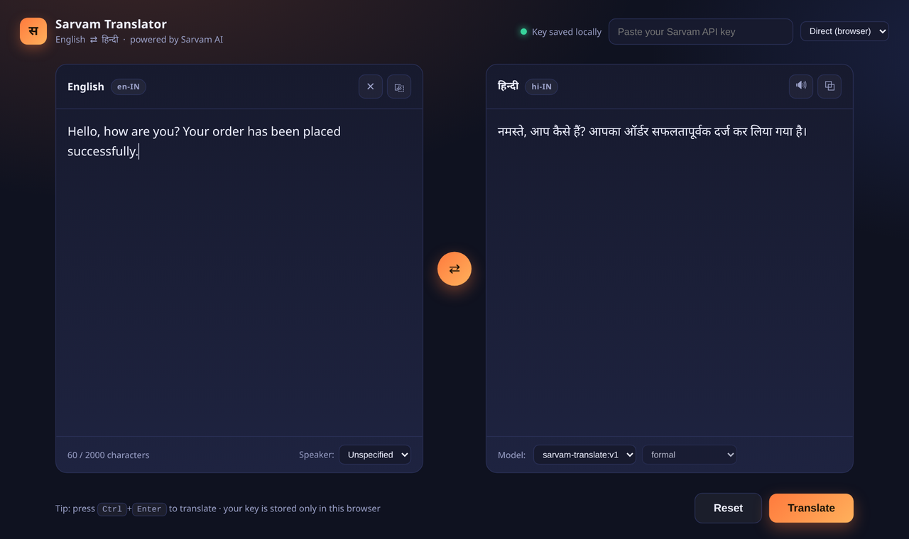

# Sarvam Translator — English ⇄ हिन्दी

A single-page translator built on [Sarvam AI](https://docs.sarvam.ai), translating between **English and Hindi** in both directions. Built as a hackathon / project demo for the theme **"Build with Sarvam AI"**.



## What it does

- **Bidirectional English ⇄ Hindi translation** using the Sarvam `/translate` API.
- **Two ways to reach the API** — call it directly from the browser, or route through a tiny included local proxy (recommended; avoids browser CORS issues).
- **Model choice** — `sarvam-translate:v1` (formal, 2,000-char input) or `mayura:v1` (colloquial / code-mixed tones, auto language detection, 1,000-char input).
- **Speaker gender** and **tone** controls for more natural output.
- **Copy** and **Listen** buttons (listen uses the browser's built-in speech synthesis — no extra API).
- Character counter that tracks the active model's limit, keyboard shortcut (`Ctrl/⌘ + Enter`), and clear error messages.

Your API key is entered in the page and stored **only in your browser's local storage**. Nothing is hardcoded, and nothing is sent anywhere except Sarvam.

## Quick start

You need a Sarvam API key — get one from the [Sarvam dashboard](https://dashboard.sarvam.ai).

```bash
# 1. Clone
git clone https://github.com/<your-username>/sarvam-translator.git
cd sarvam-translator

# 2. Run the local server (standard library only — nothing to install)
python server.py

# 3. Open the app
#    http://localhost:8000
```

In the top-right corner:

1. Pick **Local proxy** from the dropdown.
2. Paste your Sarvam API key — or set it once in the environment:

   ```bash
   export SARVAM_API_KEY="your-key-here"
   python server.py
   ```

That's it. Type English (or Hindi), press **Translate**.

## Running without the proxy

Opening `translator.html` directly in a browser also works, using the **Direct** mode in the dropdown. Many browsers block cross-origin calls to `api.sarvam.ai` (CORS), so if translation fails with a network error, switch to **Local proxy** and run `server.py`. This is why the proxy exists.

## Project structure

```
.
├── translator.html   # the entire app — one self-contained page, no build step
├── server.py         # optional local server + API proxy (stdlib only)
├── LICENSE
└── README.md
```

## How it calls Sarvam

```http
POST https://api.sarvam.ai/translate
Content-Type: application/json
api-subscription-key: <YOUR_KEY>

{
  "input": "Hello, how are you?",
  "source_language_code": "en-IN",
  "target_language_code": "hi-IN",
  "model": "sarvam-translate:v1"
}
```

The response contains `translated_text` and the detected `source_language_code`. See the [Sarvam API docs](https://docs.sarvam.ai) for the full parameter list.

## Extending it

The UI already reads language codes from a small table at the top of the script, so adding more of India's 22 scheduled languages is mostly a matter of extending that map and the dropdowns. Voice input (Sarvam speech-to-text) and document translation are natural next steps.

## License

MIT — see [LICENSE](LICENSE).
